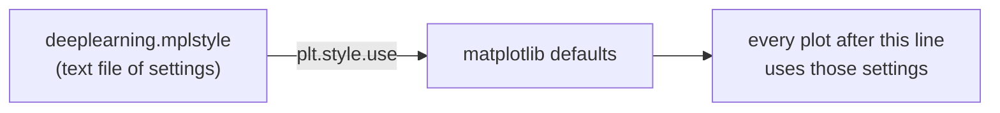

# 🐍 Week 1 – Python Lessons

---

## 1. `plt.style.use('./deeplearning.mplstyle')`

> **TL;DR:** It applies the course's look to every plot. It's cosmetic only and doesn't change the math.



### 🧩 Parts of the line

| Piece | Meaning |
|---|---|
| `plt` | `matplotlib.pyplot`, the plotting library |
| `.style.use(...)` | load a style (like a theme) |
| `'./deeplearning.mplstyle'` | style file in the **same folder** as the notebook (`./`) |

### 🎨 What's inside the file

- 🖍️ thick lines (`lines.linewidth: 4`)
- 🌈 course colors: blue, orange, pink, purple, red
- 🔤 small sans-serif font (size 8)
- ⬜ white background, no tick marks

### ⚠️ Gotcha
`./` = the folder you run the notebook from.
Run it from somewhere else → **`OSError: file not found`**.

### 🧪 Try it
```python
plt.style.use('default')          # back to matplotlib's default look
plt.style.use('ggplot')           # built-in theme
print(plt.style.available)        # list all built-in themes
```
