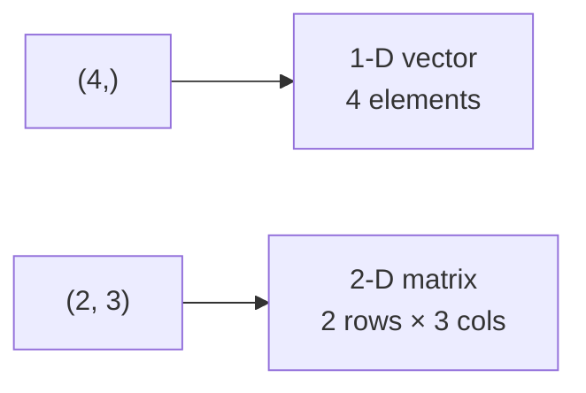

# 🐍 Week 2 – Python Lessons

---

## 1. NumPy arrays: shape & dtype

> **TL;DR:** Always check **`a.shape`** and **`a.dtype`**. Most ML bugs are shape bugs.



### 🏗️ Creating arrays

| Code | Result | Takes a shape? |
|---|---|---|
| `np.zeros(4)` / `np.zeros((4,))` | `[0. 0. 0. 0.]` | ✅ |
| `np.random.random_sample(4)` | 4 random floats | ✅ |
| `np.arange(4.)` | `[0. 1. 2. 3.]` | ❌ (start/stop/step) |
| `np.random.rand(4)` | 4 random floats | ❌ (separate ints) |
| `np.array([5,4,3,2])` | your values | ❌ |

### 🔢 dtype rule
- All ints → `int64`: `np.array([5,4,3,2])`
- **One** float → everything `float64`: `np.array([5.,4,3,2])`

### 🧪 Try it (guess first!)
```python
np.zeros((2, 3)).shape         # ?
np.array([1, 2.5]).dtype       # ?
np.arange(1, 10, 2)            # ?
```
